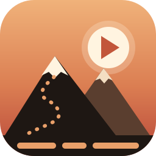

# Rando Cut sur iPhone

Montage automatique des vidéos GoPro (vacances, randonnées), **directement sur l'iPhone** : on choisit ses vidéos,
l'appli garde les meilleurs moments (HiLight d'abord, puis mouvement, voix, netteté, dans l'ordre de la journée) et
fabrique un film MP4 avec musique et titre. Avant la fabrication, une liste à cocher propose des ajouts : textes
(titre, date et heure, générique), carte du parcours et profil d'altitude (GPS de la GoPro), ralenti sur les HiLight,
accéléré du chemin, ambiance de couleurs, photos glissées à leur heure.

**Rien n'est envoyé sur internet** : les vidéos sont lues et montées sur le téléphone, les originaux ne sont jamais
modifiés.

## L'utiliser

1. Sur l'iPhone (iOS 26 ou plus récent), ouvrir dans **Safari** : https://csaintecluque-ui.github.io/rando-cut-iphone/
2. Bouton **Partager** › **Sur l'écran d'accueil**. L'appli marche ensuite même sans réseau.

## À savoir

- Cette copie est mise à jour depuis le projet Rando Cut : ne pas la modifier directement ici.
- Bibliothèques embarquées et licences : `vendor/LISEZMOI.md`.
